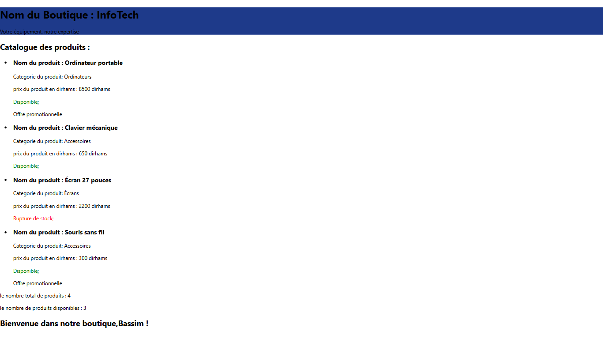

# Catalogue Informatique — React

## About the project

This project is a computer products catalog developed with React as part of my S3 Front-End Development course at ESTL, Morocco.

The application presents a computer store, a personalized welcome message, a catalog summary, and a dynamic list of products.

## Screenshot



## Features

- Display the store name and slogan.
- Show a personalized welcome message.
- Display the total number of products and available products.
- Show product names, categories, and prices in Moroccan dirhams (DH).
- Indicate product availability and promotions.
- Generate product cards dynamically using `map()`.

## Technologies

- React
- JavaScript
- JSX
- HTML and CSS

## Concepts practiced

- Functional components and a class component.
- Props and component reuse.
- Conditional rendering.
- Inline styles.
- Array mapping with `map()` and unique keys.
- Import and export between components.

## Installation

Make sure Node.js and npm are installed.

```bash
npm install
npm start
```

## Project structure

```text
src/
├── App.js
├── EnteteBoutique.js
├── MessageAccueil.js
├── ResumeCatalogue.js
├── Produit.js
└── Catalogue.js
```

## Author

Bassim Zakaria Software Development student at ESTL, Morocco.

Created for educational purposes as part of my Front-End Development coursework.
